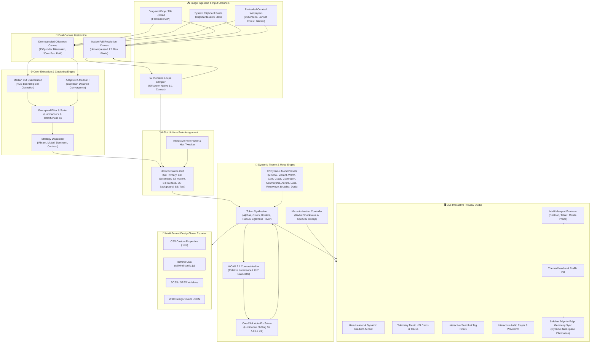

<h1 align="center">Img2UI</h1>

<p align="center">
  

</p>

<h2 align="center"><strong>Intelligent Wallpaper-to-Design System Generator & Real-Time Theming Studio.</strong><br> Extract harmonious 6-slot color roles, compile reactive design tokens, and audit WCAG AA/AAA accessibility in real-time.</h2>

<p align="center">
  <a href="#architecture-diagram"></a>
  <a href="#installation--setup-guide"></a>
  <a href="https://vite.dev"></a>
  <a href="#color-extraction-pipeline--mathematical-mechanics"></a>
  <a href="#3-real-time-wcag-21-contrast-auditing--one-click-auto-fix"></a>
  <a href="#2-12-curated-dynamic-theme-moods"></a>
  <a href="LICENSE"></a>
</p>

<details>
<summary style="font-size: 24px; font-weight: bold; cursor: pointer;"><h1>Table of Contents</h1></summary>

- [Architecture Diagram](#architecture-diagram)
- [Demo Video & Walkthrough](#demo-video--walkthrough)
- [Overview & Motivation](#overview--motivation)
- [Implementation Architecture](#implementation-architecture)
  - [Modular Directory Structure](#modular-directory-structure)
  - [Zero-Dependency Runtime](#zero-dependency-runtime)
- [Color Extraction Pipeline & Mathematical Mechanics](#color-extraction-pipeline--mathematical-mechanics)
  - [1. Dual-Canvas Ingestion & Preprocessing](#1-dual-canvas-ingestion--preprocessing)
  - [2. Median Cut Vector Quantization (Color Thief Core)](#2-median-cut-vector-quantization-color-thief-core)
  - [3. Adaptive K-Means++ Clustering & Convergence](#3-adaptive-k-means-clustering--convergence)
  - [4. Perceptual Colorfulness & Relative Luminance Filtering](#4-perceptual-colorfulness--relative-luminance-filtering)
  - [5. Extraction Strategy Heuristics](#5-extraction-strategy-heuristics)
  - [6. Full-Scale Precision Pixel Sampler & 5x Magnifier Loupe](#6-full-scale-precision-pixel-sampler--5x-magnifier-loupe)
- [Dynamic Theme Generation Logic & Mood Engine](#dynamic-theme-generation-logic--mood-engine)
  - [1. 6-Slot Uniform Role Mapping](#1-6-slot-uniform-role-mapping)
  - [2. Algorithmic Token Derivation](#2-algorithmic-token-derivation)
  - [3. 12 Curated Dynamic Theme Moods](#3-12-curated-dynamic-theme-moods)
  - [4. Real-Time WCAG 2.1 Contrast Auditing & One-Click Auto-Fix](#4-real-time-wcag-21-contrast-auditing--one-click-auto-fix)
  - [5. Fluid CSS Transitions & Shockwave Micro-Animations](#5-fluid-css-transitions--shockwave-micro-animations)
- [Design Decisions & Engineering Philosophy](#design-decisions--engineering-philosophy)
  - [1. Pure CSS Custom Property Cascading vs. CSS-in-JS](#1-pure-css-custom-property-cascading-vs-css-in-js)
  - [2. Dynamic Edge-to-Edge Sidebar Geometry (Null Space Elimination)](#2-dynamic-edge-to-edge-sidebar-geometry-null-space-elimination)
  - [3. Dual-Canvas Strategy: High-Throughput vs. Sub-Pixel Precision](#3-dual-canvas-strategy-high-throughput-vs-sub-pixel-precision)
  - [4. Multi-Device Viewport Emulation](#4-multi-device-viewport-emulation)
- [Multi-Format Token Export Engine](#multi-format-token-export-engine)
- [Deployment](#deployment)
  - [1. GitHub Pages (Automated CI/CD)](#1-github-pages-automated-cicd)
  - [2. Cloud Deployment (Render / Vercel / Netlify)](#2-cloud-deployment-render--vercel--netlify)
- [Installation & Setup Guide](#installation--setup-guide)
  - [1. Prerequisites](#1-prerequisites)
  - [2. Clone & Install](#2-clone--install)
  - [3. Start Development Server](#3-start-development-server)
  - [4. Production Build](#4-production-build)
- [License](#license)

</details>

---

# Architecture Diagram



---

## Demo Video & Deployment


https://github.com/user-attachments/assets/c61308b5-bee0-4a07-a8d6-46eb350ccd06


[Deployed Site (Live on GitHub Pages)](https://omega131.github.io/Img2UI/)

A complete demonstration video covering:
1. **End-to-End Extraction**: Loading custom wallpapers via drag-and-drop, clipboard paste (`Ctrl+V`), and curated 4K sources.
2. **Sub-Pixel Precision Sampling**: Using the 5x Magnifier Loupe on the uncompressed raw canvas to target exact chromatic slots.
3. **Dynamic Theming & Micro-Animations**: Live switching across 12 dynamic moods (from *Aurora* to *Neo-Brutalist*) with radial shockwaves and specular sweeps.
4. **Real-Time WCAG 2.1 Accessibility**: Auditing contrast ratios in real time with one-click automatic AA/AAA contrast resolution.
5. **Responsive Viewport Containment**: Testing across Desktop, Tablet, and Mobile Phone shells with Dynamic Island.
6. **Multi-Format Token Export**: Compiling ready-to-use CSS Variables, Tailwind CSS configs, SCSS variables, and W3C Design Tokens JSON.

---

# Overview & Motivation

Modern UI design systems frequently rely on wallpaper-driven theming (seen in macOS Sonoma, Android Material You, and Windows Mica). However, developers and designers often face critical bottlenecks:

- **Manual Color Hunting**: Extracting harmonious colors via third-party eyedroppers is slow, biased, and rarely accounts for luminance balance across interactive states.
- **Inaccessible Contrast Failures**: Extracted palettes placed directly onto interfaces consistently violate WCAG AA/AAA guidelines, resulting in illegible typography and unusable buttons.
- **Disconnected Visual Identity**: Color is only one dimension of a theme. Modern design requires harmonious control of border radius, backdrop blur, elevation shadows, typography, and specular glow.
- **Tooling Overhead**: Existing theming libraries pull in hundreds of megabytes of framework dependencies, complex bundler plugins, and rigid class conventions.

**Img2UI** solves these challenges by providing a standalone, zero-dependency browser studio that extracts 6-slot chromatic roles from any image, evaluates contrast compliance in real time, and compiles cohesive, animated design systems ready for production deployment.

---

# Implementation Architecture

### Modular Directory Structure

The project is structured into cohesive, decoupled ES modules:

```
Img2UI/
├── index.html                # High-fidelity preview stage and control studio
├── package.json              # Vite scripts and workspace metadata
├── vite.config.js            # Build configuration
├── public/
│   └── wallpapers/           # Curated preloaded wallpapers (4K WebP / JPG)
│       ├── cyberpunk.jpg     # Obsidian neon metropolitan palette
│       ├── sunset.jpg        # Amber and terracotta warm horizon
│       ├── forest.jpg        # Organic emerald foliage and moss
│       └── glacier.jpg       # Arctic ice cyan and slate
└── src/
    ├── app.js                # Main application orchestrator & event coordinator
    ├── color-extractor.js    # Canvas quantization, K-Means++, Median Cut, and Loupe
    ├── theme-engine.js       # Central token synthesis, role mapping, and DOM cascading
    ├── presets.js            # 12 curated dynamic theme mood definitions
    ├── contrast-checker.js   # WCAG 2.1 relative luminance and contrast auditor
    ├── export-manager.js     # Multi-format token generators (CSS, Tailwind, SCSS, JSON)
    ├── sample-wallpapers.js  # Curated wallpaper registry with recommended moods
    └── style.css             # Vanilla CSS design system, micro-animations, and viewport layouts
```

### Zero-Dependency Runtime

The runtime application operates with **0 runtime dependencies**. It compiles directly to native web standards:
- **Vanilla JavaScript (ES2022 Modules)**: Native browser execution without virtual DOM abstractions.
- **Vanilla CSS3 Custom Properties**: Dynamic stylesheet recalculation via CSS variables (`--theme-*`) yielding instant 60fps cascading updates.
- **HTML5 Canvas 2D API**: Hardware-accelerated pixel extraction, vector quantization, and sub-pixel magnification.

---

# Color Extraction Pipeline & Mathematical Mechanics

### 1. Dual-Canvas Ingestion & Preprocessing

When an image is loaded (via file upload, drag-and-drop, clipboard paste, or preloaded wallpaper), it is ingested into a **dual-canvas architecture**:

1. **Downsampled Extraction Canvas**: Scaled proportionally such that $\max(\text{width}, \text{height}) \le 150\text{ px}$. This dramatically reduces pixel count from millions to $< 22,500\text{ pixels}$, allowing vector quantization and clustering to complete in **$< 35\text{ ms}$**.
2. **Uncompressed Full-Resolution Canvas**: Maintains the uncompressed $1:1$ source image dimensions, dedicated solely to the **Precision Pixel Sampler** and **5x Magnifier Loupe**.

Transparent pixels ($\alpha < 128$) are automatically pruned during pixel buffer ingestion.

### 2. Median Cut Vector Quantization (Color Thief Core)

The Median Cut algorithm treats color extraction as recursive spatial partitioning in 3D RGB color space:

1. All pixels are enclosed in an initial axis-aligned bounding box defined by $[\min(R), \max(R)]$, $[\min(G), \max(G)]$, $[\min(B), \max(B)]$.
2. The bounding box dimension with the greatest delta is determined:
   $$\Delta_{max} = \max(\Delta R, \Delta G, \Delta B)$$
3. Pixels inside the box are sorted along this maximal axis and split at the median index into two sub-boxes.
4. Steps 2–3 repeat recursively until $K = 16$ quantization boxes are created.
5. The representative color of each box is calculated as the centroid arithmetic mean:
   $$\bar{C} = \left( \frac{1}{N}\sum R_i, \frac{1}{N}\sum G_i, \frac{1}{N}\sum B_i \right)$$

### 3. Adaptive K-Means++ Clustering & Convergence

To complement Median Cut, Img2UI implements an unsupervised vector clustering pipeline with **K-Means++ seeding** to prevent local minima traps:

- **Seeding**: The first centroid $\mu_1$ is chosen uniformly at random from the pixel set. Subsequent centroids $\mu_j$ are chosen with probability proportional to the squared Euclidean distance from the nearest existing centroid:
  $$P(x) = \frac{D(x)^2}{\sum_{x' \in X} D(x')^2}$$
- **Iterative Convergence**: Pixels are assigned to the closest centroid $\arg\min_j \|x_i - \mu_j\|_2$. Centroids are updated to the mean of their assigned clusters until convergence ($\Delta \mu < 1.0$) or a cap of 12 iterations is reached.

### 4. Perceptual Colorfulness & Relative Luminance Filtering

Extracted clusters are evaluated under perceptual color theory:

- **WCAG 2.1 Relative Luminance ($L$)**:
  $$L = 0.2126 R_{lin} + 0.7152 G_{lin} + 0.0722 B_{lin}$$
  where:
  $$C_{lin} = \begin{cases} \frac{C_{srgb}}{12.92} & \text{if } C_{srgb} \le 0.04045 \\ \left(\frac{C_{srgb} + 0.055}{1.055}\right)^{2.4} & \text{otherwise} \end{cases}$$
- **Hasler-Süsstrunk Colorfulness Metric ($C$)**:
  $$C = \sqrt{\sigma_{rg}^2 + \sigma_{yb}^2} + 0.3 \sqrt{\mu_{rg}^2 + \mu_{yb}^2}$$
  approximated in fast-path via channel variance:
  $$C \approx \sqrt{(R - G)^2 + (R - B)^2 + (G - B)^2}$$

### 5. Extraction Strategy Heuristics

Users can switch extraction strategies on the fly:
- **Vibrant & Accent (Recommended)**: Emphasizes high-chroma accents with moderate lightness ($0.35 \le L \le 0.75$), optimizing for vivid call-to-actions.
- **K-Means Clustering**: Unsupervised geometric centroids representing true mathematical color density.
- **Median Cut**: Broad tonal balance across dark, mid, and highlight channel distributions.
- **Pastel & Muted**: Favors low-saturation, high-lightness tones for softer aesthetic palettes.

### 6. Full-Scale Precision Pixel Sampler & 5x Magnifier Loupe

For surgical color selection:
- An interactive modal renders the full-scale wallpaper on an uncompressed canvas.
- A **5x Magnifier Loupe** renders a magnified $16 \times 16$ pixel region around the cursor using nearest-neighbor interpolation (`imageSmoothingEnabled = false`).
- Displays live RGB/Hex coordinates and samples exact pixel values directly into any targeted palette slot with a single click.

---

# Dynamic Theme Generation Logic & Mood Engine

### 1. 6-Slot Uniform Role Mapping

Img2UI standardizes color distribution across a unified 6-slot hierarchy:

| Slot | Role | Primary Assignment in UI |
| :---: | :--- | :--- |
| **S1** | **Primary** | Main CTA buttons, active tab indicators, primary brand marks, focus rings |
| **S2** | **Secondary** | Secondary action buttons, badge outlines, auxiliary tags, audio controls |
| **S3** | **Accent** | Metric trend indicators, heading highlights, glowing status dots, notifications |
| **S4** | **Surface** | Card backgrounds, navbar containers, modal backdrops (with dynamic alpha) |
| **S5** | **Background** | Main app canvas tint, underlying wallpaper scrim, global backdrop |
| **S6** | **Text / Border** | Primary text headers, secondary body labels, subtle component borders |

### 2. Algorithmic Token Derivation

The `ThemeEngine` compiles raw slot hex values into an expansive set of reactive CSS custom properties:
- **Specular Alpha Scales**: Automatically computes `rgba()` strings for 15%, 25%, 30%, 35%, and 50% opacity tiers for subtle glows, chip backgrounds, and frosted borders.
- **Luminance-Preserving Hover States**: Shorter or taller luminance shifts depending on base lightness:
  $$L_{hover} = \begin{cases} L - 0.08 & \text{if } L > 0.50 \text{ (darkens light colors)} \\ L + 0.08 & \text{if } L \le 0.50 \text{ (brightens dark colors)} \end{cases}$$
- **Surface Contrast Auto-Detect**: Determines whether the card surface is dark or light via relative luminance threshold ($L_{surface} < 0.35$), dynamically setting primary text to `#FFFFFF` or `#090D16` and border alphas accordingly.
- **Dynamic Derivative Gradients**: Blends Primary, Secondary, and Accent slots into bespoke linear gradients used across headings and brand accents.

---

### 3. 12 Curated Dynamic Theme Moods

Theme moods modify spatial geometry, blur, saturation, contrast, shadows, and typography:

| Mood Preset | Badge | Character & Visual Identity |
| :--- | :--- | :--- |
| **Minimal** | `Clean & Muted` | Crisp 1px solid borders, low saturation (0.75x), 4px blur, high legibility Inter font. |
| **Vibrant** | `Bold & Punchy` | High saturation (1.35x), bold multi-stop gradient headings, 16px radius, glowing borders. |
| **Warm** | `Golden & Cozy` | +24° amber hue shift, terracotta undertones, soft amber drop shadows. |
| **Cool** | `Arctic & Crisp` | -25° cyan/teal tone shift, slate undertones, icy blue card specular highlights. |
| **Glass** | `Frosted Glass` | Heavy backdrop blur (22px), 38% surface opacity, luminous top-edge specular borders. |
| **Cyberpunk** | `Neon Synth` | Obsidian midnight canvas, neon rim lighting (1.5px), JetBrains Mono uppercase headings. |
| **Neumorphic** | `Soft UI` | Dual-shadow embossed cards (`8px 8px 18px` dark / `-6px -6px 14px` light), 20px organic curves. |
| **Aurora** | `Boreal Aura` | Northern lights spectral glow, emerald/cyan accents, deep oceanic indigo backdrop. |
| **Obsidian Luxe** | `Executive Gold` | Ultra-dark obsidian canvas, champagne gold metallic borders (`#D4AF37`), executive elevation. |
| **Retrowave** | `80s Outrun` | 80s arcade vaporwave, hot neon magenta, solar sunset orange, monospace retro headings. |
| **Neo-Brutalist** | `Raw & Punchy` | 0px sharp corners, 2.5px solid borders, hard 5px isometric drop shadows, uppercase headers. |
| **Twilight Dusk** | `Dusk Horizon` | Dusk coral and violet gradient horizons, gentle warm illumination, feathered 22px radius. |

---

### 4. Real-Time WCAG 2.1 Contrast Auditing & One-Click Auto-Fix

The `ContrastChecker` continuously audits contrast ratios for all critical text and button pairs:
$$CR = \frac{L_1 + 0.05}{L_2 + 0.05}$$
where $L_1$ is the lighter luminance and $L_2$ is the darker luminance.

- **Threshold Compliance**:
  - **AAA Pass**: $CR \ge 7.0:1$ (Normal text) / $CR \ge 4.5:1$ (Large text)
  - **AA Pass**: $CR \ge 4.5:1$ (Normal text) / $CR \ge 3.0:1$ (Large text)
  - **Fail**: $CR < 4.5:1$
- **Intelligent Auto-Fix Contrast Solver**:
  When invoked, the engine analyzes the contrast delta between surface and text. It shifts the lightness coordinate in HSL color space iteratively while preserving the exact base hue and saturation, achieving guaranteed WCAG AA compliance with zero aesthetic disruption.

---

### 5. Fluid CSS Transitions & Shockwave Micro-Animations

Theme changes feature custom physics-inspired micro-interactions:
1. **Universal Fluid Transitions**: Preview components transition `background`, `border-color`, `border-radius`, `box-shadow`, and `color` using a custom `0.45s cubic-bezier(0.16, 1, 0.3, 1)` easing curve.
2. **Radial Shockwave Burst**: An absolute layer (`.theme-shockwave-layer`) emits an expanding radial light wave across the mockup canvas whenever a theme mood or wallpaper changes (`@keyframes themeShockwave`).
3. **Heading Light Sweep**: Triggers a specular brightness surge (`@keyframes textShineSweep`) across gradient derivative text.
4. **Cascading Swatch Pop**: Palette swatches in the uniform grid pop with a staggered 40ms sequence (`@keyframes swatchPop`).
5. **Audit Badge Pulse**: The accessibility badge pulses on contrast re-evaluation (`@keyframes auditBadgePulse`).

---

# Design Decisions & Engineering Philosophy

### 1. Pure CSS Custom Property Cascading vs. CSS-in-JS

Instead of re-rendering component trees with React/Vue or generating utility classes with a heavy CSS-in-JS engine, Img2UI injects calculated values directly into CSS custom properties (`--theme-*`) on `#preview-container`. The browser's native C++ style resolution engine recalculates all styles in a single frame, achieving buttery smooth **60fps transitions without script lag**.

### 2. Dynamic Edge-to-Edge Sidebar Geometry (Null Space Elimination)

In dual-pane studio layouts, a persistent issue is "null space" (empty dead zones) appearing beneath the controls sidebar when the main preview container is tall.

Img2UI introduces dynamic geometry synchronization (`syncSidebarLength()`):
- Using a `ResizeObserver` coupled with viewport resize listeners, the script measures the exact pixel bottom edge of the preview stage:
  $$\text{targetHeight} = \text{previewContainer.offsetTop} + \text{previewContainer.offsetHeight}$$
- The studio sidebar's `height` and `max-height` are pinned dynamically to this target, allowing the sidebar's internal content to scroll smoothly with custom scrollbars while keeping its bottom border **pixel-perfectly aligned with the mockup container (0px delta)**.

### 3. Dual-Canvas Strategy: High-Throughput vs. Sub-Pixel Precision

Single-canvas pipelines force a painful trade-off between quantization speed and sampling fidelity. Img2UI decouples these two concerns:
- Fast downsampled canvas ($150\text{px}$) for instant palette extraction on upload.
- Full-resolution uncompressed canvas for the $16 \times 16$ 5x magnifier loupe, enabling precision pixel sampling without blur artifacts.

### 4. Multi-Device Viewport Emulation

Designers need to verify token adaptability across device form factors. Img2UI includes a hardware-accelerated viewport switcher:
- **Desktop**: Expansive $1100\text{px}$ dashboard with multi-column stats, search bar, and filter chips.
- **Tablet**: Responsive $768\text{px}$ layout with responsive column reflow.
- **Mobile Phone Shell**: $380\text{px}$ phone enclosure complete with speaker notch, front camera, Dynamic Island indicator, and home swipe bar.

---

# Multi-Format Token Export Engine

Themes can be exported instantly to production codebases via the built-in modal:

```json
// Sample W3C Design Tokens Community Group JSON Export
{
  "theme": {
    "name": "img2ui-aurora",
    "primary": { "value": "#06B6D4", "type": "color" },
    "secondary": { "value": "#52C3DA", "type": "color" },
    "accent": { "value": "#A78BFA", "type": "color" },
    "surface": { "value": "rgba(18, 30, 48, 0.72)", "type": "color" },
    "background": { "value": "#0A111E", "type": "color" },
    "radius": { "value": "16px", "type": "dimension" }
  }
}
```

Supports:
1. **CSS Custom Properties**: `:root { --theme-primary: ...; }`
2. **Tailwind CSS**: `module.exports = { theme: { extend: { colors: { ... } } } }`
3. **SCSS Variables**: `$theme-primary: #...;`
4. **Design Tokens JSON**: Standardized schema for Figma, Style Dictionary, and Token Studio.

---

# Deployment

### 1. GitHub Pages (Automated CI/CD)

The production application is continuously deployed to GitHub Pages on every push to `main` via [GitHub Actions](.github/workflows/deploy.yml):

- **Live URL**: [https://omega131.github.io/Img2UI/](https://omega131.github.io/Img2UI/)
- **Pipeline**: Automated checkout, Node.js 20 caching, `npm run build`, artifact upload, and zero-downtime deployment via `actions/deploy-pages@v4`.

### 2. Cloud Deployment (Render / Vercel / Netlify)

Because Img2UI is built as a zero-runtime-dependency static application, it can also be hosted on any static cloud provider with zero configuration:

| Cloud Provider | Service Type | Build Command | Publish Directory |
| :--- | :--- | :--- | :--- |
| **GitHub Pages** *(Active)* | Static Pages | `npm run build` | `dist` |
| **Render** | Static Site | `npm run build` | `dist` |
| **Vercel** | Vite Frontend | `npm run build` | `dist` |
| **Netlify** | Static Site | `npm run build` | `dist` |

---

# Installation & Setup Guide

### 1. Prerequisites
- **Node.js**: v18.0.0 or higher
- **npm**: v9.0.0 or higher

### 2. Clone & Install
```bash
# Clone the repository
git clone https://github.com/Omega131/Img2UI.git

# Navigate into project directory
cd Img2UI

# Install dev dependencies
npm install
```

### 3. Start Development Server
```bash
npm run dev
```
Open [http://localhost:5173/](http://localhost:5173/) in your web browser.

### 4. Production Build
```bash
npm run build
```
Generates optimized, bundled assets in the `dist/` directory.

---

# License

Distributed under the **MIT License**. See `LICENSE` for more information.
